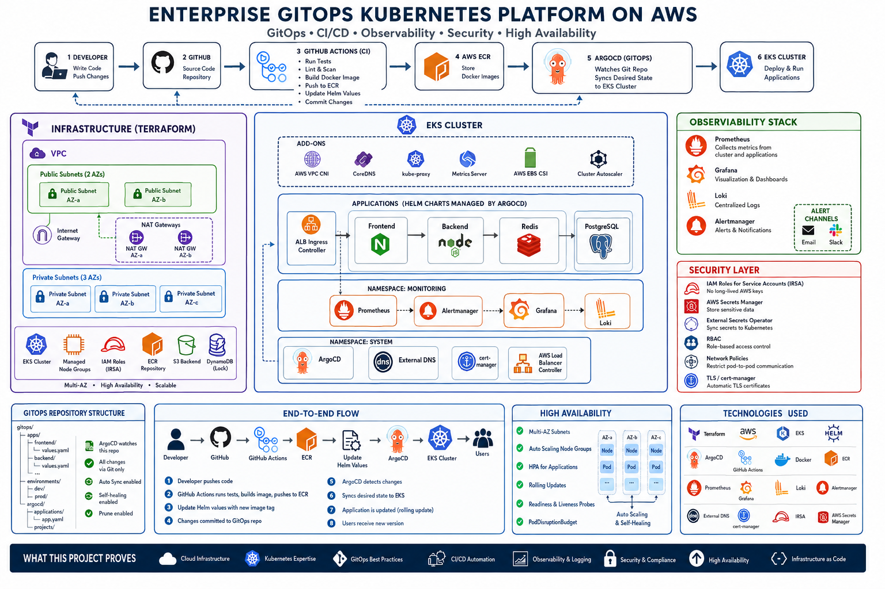

# AWS GitOps Kubernetes Platform

**An end-to-end DevOps portfolio project** that brings application development,
AWS infrastructure, Kubernetes operations, security, and GitOps delivery into
one working platform.

I built a booking application and the cloud platform around it. A push to the
main branch builds and publishes the frontend and backend images; Argo CD then
deploys the updated Helm release to Amazon EKS.



## What this project demonstrates

| Area | Work demonstrated |
| --- | --- |
| Cloud infrastructure | Modular Terraform for VPC networking, EKS, ECR, RDS PostgreSQL, ElastiCache Redis, IAM, KMS, security groups, CloudWatch, and SNS |
| Kubernetes | Helm deployments and services, ALB Ingress, health probes, resource requests and limits, horizontal pod autoscaling, and PodDisruptionBudgets |
| GitOps | Argo CD root and application definitions with automated sync, pruning, and self-healing |
| CI/CD | GitHub Actions builds both app images, tags them by commit SHA, pushes to ECR, and updates Helm values for Argo CD to deploy |
| Cloud security | GitHub Actions OIDC, EKS Pod Identity, least-scoped workload permissions, Secrets Manager integration, and encrypted infrastructure |
| Application operations | React frontend, Express API, PostgreSQL data layer, JWT authentication, readiness and liveness checks, and verified TLS to RDS |

## Delivery flow

```text
Push to main
    -> GitHub Actions assumes an AWS role through OIDC
    -> Build frontend and backend Docker images
    -> Push commit-SHA tagged images to Amazon ECR
    -> Update image tags in Helm values
    -> Argo CD detects the Git change and syncs the app to EKS
    -> AWS Load Balancer Controller provisions the ALB for the Ingress
```

The infrastructure and cluster add-ons use separate Terraform roots and state
files. The dev root provisions AWS resources; the bootstrap root installs Argo
CD, the AWS Load Balancer Controller, and External Secrets Operator into the
cluster.

## Engineering highlights

- **Short-lived AWS access for CI:** GitHub Actions assumes an IAM role through
  OIDC, avoiding static AWS access keys in workflow secrets.
- **Workload identity:** EKS Pod Identity associates workloads with IAM roles.
  External Secrets Operator reads the app's database credentials and JWT secret
  from AWS Secrets Manager.
- **Safer database connectivity:** the backend uses a dedicated PostgreSQL app
  account and verifies the RDS TLS certificate with the AWS CA bundle.
- **Resilient application deployment:** Kubernetes probes, autoscaling,
  disruption budgets, resource settings, and ALB ingress are defined in Helm.
- **Repeatable infrastructure:** Terraform modules separate networking,
  compute, data services, IAM, encryption, and monitoring concerns.
- **Git as the deployment source:** Argo CD reconciles the cluster against the
  Helm chart in the repository, including automated pruning and self-healing.

## Problems solved

- Fixed the frontend API URL so registration uses `/api/auth/register` behind
  the deployed ingress rather than an unset environment value.
- Resolved PostgreSQL TLS verification failures by adding the AWS CA bundle to
  the chart and enabling certificate verification in the backend connection.
- Replaced master database credentials in the app with a dedicated database
  user, delivered through Secrets Manager and External Secrets Operator.
- Connected CI image publishing to GitOps rollout by committing the image SHA
  tags to Helm values after successful frontend and backend builds.

## Application

The booking app supports registration and login, browsing active items, booking
requests, and an admin dashboard for managing items and booking status. The
frontend is React with Vite; the API uses Node.js and Express, PostgreSQL, and
JWT role-based authorization.

### Screenshots

**Booking application**


**GitHub Actions image build and publish workflow**


**Argo CD application health and sync status**


## Technology

**AWS:** VPC, EKS, ECR, RDS PostgreSQL, ElastiCache Redis, IAM, KMS, Secrets
Manager, CloudWatch, SNS  
**Platform:** Terraform, Kubernetes, Docker, Helm, Argo CD, External Secrets
Operator  
**Delivery:** GitHub Actions, GitHub OIDC, Amazon ECR, EKS Pod Identity  
**Application:** React, Vite, Node.js, Express, PostgreSQL

## Explore the repository

- [`terraform/`](terraform/) — AWS infrastructure and cluster bootstrap roots
- [`helm/`](helm/) — app chart, Kubernetes templates, and environment values
- [`gitops/`](gitops/) — Argo CD root and application definitions
- [`app/`](app/) — frontend, backend, and local Docker Compose setup
- [`.github/workflows/ci.yaml`](.github/workflows/ci.yaml) — image build and
  deployment update pipeline
- [`assets/architecture.png`](assets/architecture.png) — platform diagram
- [`app/README.md`](app/README.md) — local app setup and API overview

To run the application locally, follow [`app/README.md`](app/README.md). The
cloud deployment requires AWS credentials, Terraform backend access, configured
GitHub OIDC, and a network path to the EKS API.
